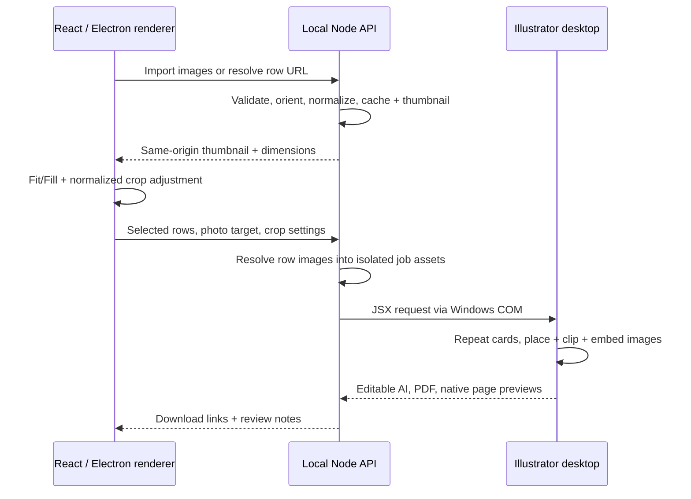

# Card images

Image replacement is optional. **Keep original** is the default and preserves the artwork's photo.

## User journey

1. Upload your Excel/CSV workbook and select the people to print.
2. Upload your AI artwork or packaged ZIP, then select a sample card. Existing saved templates may need **Analyze photo areas** once to collect the new photo metadata.
3. Under **Photos for your cards**, choose one source:
   - **Excel column**: select a column such as `Card Image`. Cells can contain a public HTTPS image URL, `person.jpg`, `team/person.jpg`, or an absolute path ending in that imported filename. For filenames/paths, use **Choose image folder** or **Choose files**. The app matches only files you explicitly import; it never opens arbitrary disk paths from a spreadsheet.
   - **One image for all**: upload a photo from your computer. This overrides Excel image cells and applies the same photo and crop to every generated card.
4. Open **Photo** in the mapping panel, or click an outlined photo area in the artwork. Choose which photo area to replace if the card has several.
5. Select a **Preview person**. **Fill** fills the frame and crops excess edges. **Fit** shows the entire image with white space. Drag to reposition; arrow buttons and keyboard arrows provide alternatives. Zoom runs from 1× to 4×. **Reset** restores centered Fill.
6. For Excel photos, each person's adjustment is stored separately for this sample card/section. People you do not adjust use centered Fill. For a shared photo, the adjustment applies to all cards, including all sections.
7. Render a native proof, review it, then generate the editable AI and optional PDF. Blank, missing, failed or unsupported row photos retain the sample card's original image; review notes explain failures. The rest of the batch continues.

In **Multiple sections**, the image source is shared by the batch. Each section selects its own sample card/photo area and preview person from its own record range. Excel photo crops are independent between sections. Headings and months continue to work as before.

## Spreadsheet examples

| Name | Card Image |
| --- | --- |
| Ali | `https://example.com/photos/ali.png` |
| Sara | `team/sara.jpg` |
| Usman | *(blank: retain original)* |

Use direct image URLs that return image bytes without a login. Browser/cloud sharing pages are not image files. An Excel hyperlink can have a friendly display label: RowCraft retains the displayed label for text mapping and uses the hyperlink destination for image mapping. Embedded Excel pictures are not extracted.

## How it works

Illustrator inspection identifies raster/placed images and suitable artwork-only groups inside each detected card. Metadata includes the group's child-index path, artboard coordinates and clipping-path shape. The browser displays a lightweight crop overlay over Illustrator's rendered artwork. A separate close-up editor provides the same controls. This overlay previews image geometry; the **native proof** remains the authoritative view of the complete artwork, including blend effects, document colors and text.

Browser and export use the same normalized geometry: scale by the smaller axis for Fit or larger axis for Fill, multiply by zoom, then offset the remaining width/height by X/Y values from 0 to 1. This keeps crops independent of browser size and preview zoom. Illustrator clips the placed image to the original mask (or a rectangular frame), embeds it, and only then removes the sample photo. On placement failure it retains the original. Text styles and surrounding artwork are not intentionally altered.

## Storage, limits and privacy

- JPG, PNG, WebP, TIFF, AVIF and still GIF; maximum 20 MB and 40 million decoded pixels per image. Animated/multipage images and SVG are rejected. EXIF orientation is applied. Normalized assets use sRGB; photo color can differ in a CMYK document, so proof before printing.
- Imported libraries support up to 5,000 files and 2 GB of normalized images. Uploads run in batches of 20. URL preparation has up to four concurrent workers and deduplicates repeated references. Successful URL images are cached locally and reused between preview and generation.
- Filenames are matched case-insensitively. Duplicate basenames require relative folder paths. Folder imports copy the selected images; RowCraft does not monitor the source folder for later changes.
- HTTPS URL requests happen in the backend. Private/loopback/reserved IPs, credentials, custom ports and unsafe redirects are blocked; DNS results are checked and pinned. The renderer only loads local thumbnails, including in Electron. Image hosts see ordinary download requests; spreadsheets and artwork are not uploaded to those hosts.
- Web storage: `.local/images/`; desktop: `%APPDATA%\RowCraft\data\images\`. Each job also contains its own `photo-assets` so generation uses isolated files. Full-resolution normalized images are embedded in the AI output; thumbnails are only for the interface.
- Full-resolution photos can make AI/PDF batches much larger. For large print runs, prepare photos at an appropriate print resolution before importing. Native image checks cover small mixed/shared batches and section overflow; a 1,000-photo stress run has not been certified.
- Saving a mapping remembers the image source, selected area, column and shared/default crop. Individual Excel-person adjustments belong to the current session; they are not saved into reusable mappings. Original workbook/artwork files are never edited.
- To reset testing, close the app and finish jobs, then **rename/back up** the complete data directory using [desktop reset instructions](desktop/README.md#local-files-and-upgrades). In web development, rename `.local` while the server is stopped. This also clears cached images and history. Separately downloaded exports remain where you saved them.

## Template requirements

Keep each card grouped, with its photo/image group separate from its live text. A flattened full-page image does not contain independently editable photo targets. Complex effects and unusual nesting may require template preparation in Illustrator. RowCraft currently replaces one selected photo area per repeated card.

## Verification

`npm test` covers crop geometry, mapping boundaries, folder/path matching, EXIF orientation, invalid files, URL security, caching, fallbacks, workbook hyperlinks and real image API upload/preview routes, alongside existing grid/section/download tests.

With the private sample template present, run `node scripts/native-grid-check.mjs --inspect-only` and `node scripts/native-photo-check.mjs`. The photo check reopens native outputs to verify selected card counts, embedded images, Fill/Fit positions, unchanged fonts, retained missing photos, shared-photo overrides, two-section pagination and an unchanged source file. Evidence is saved under `.local/photo-check/<id>`.
