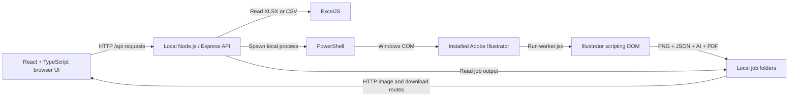
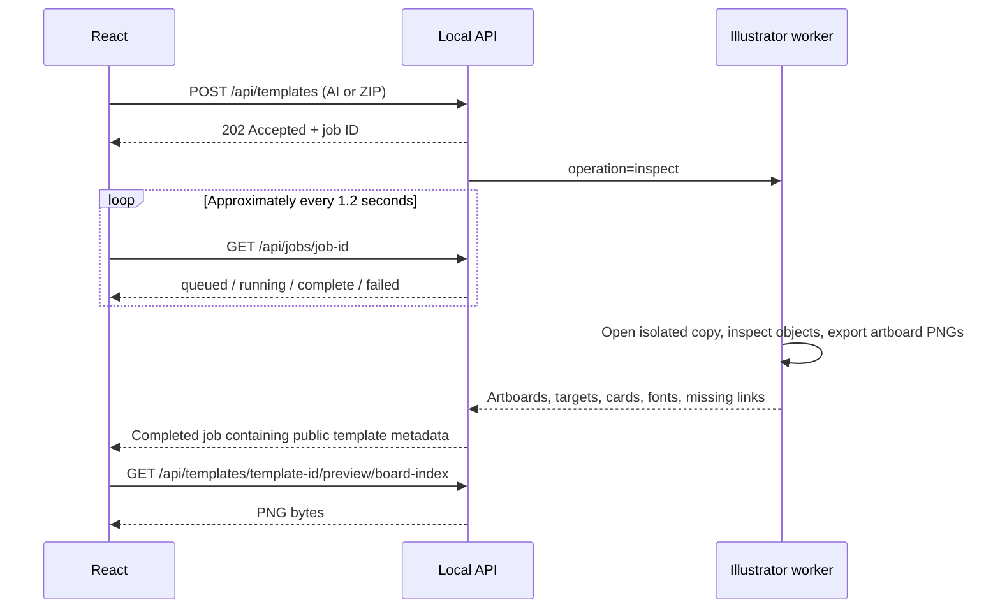

# Cover Studio — Engineering Flow

> An implementation guide to the current application, traced from its source code.
> Written on 4 November 2026. This describes the local Windows implementation; a cloud renderer is not implemented.

The section-based extension is documented in [Multiple sections in one Illustrator file](MULTI_SECTION_GUIDE.md): independent ranges, headings/months, cross-artboard planning, and the native combined exporter. The original single-card workflow described below remains available.

## 1. The central idea

**The browser is the control panel. The local backend is the bridge. Installed Illustrator is the document engine.**

React does not open or edit an `.ai` file itself. It sends HTTP requests to a Node.js server running on the same computer. Node launches PowerShell, PowerShell obtains Illustrator's Windows COM automation object, and that object runs our Illustrator JavaScript script.

Illustrator does two separate jobs:

1. **Inspect:** render the design as images and extract editable text and card geometry.
2. **Generate:** duplicate the selected card, replace its text using selected Excel records, and save the resulting artwork.

The browser displays the rendered images and puts clickable HTML boxes over them. Those boxes refer back to real Illustrator objects through IDs and metadata.

There is no screenshot recognition, OCR, LLM, MCP server, Adobe cloud API, or browser plugin in this processing path. Routine batches use ordinary application code and Illustrator's local scripting engine.

## 2. Architecture and process boundaries



| Layer | Current implementation | Responsibility |
|---|---|---|
| Interface | React 19 + TypeScript + Vite | Uploads, row selection, artboard selection, field mapping, job status, downloads |
| Standard controls | shadcn/ui, Radix UI, Tailwind CSS, semantic CSS variables | Menus, forms, dialogs, sidebar, accordion; toast uses shadcn's Base UI implementation |
| Workbook grid | TanStack Table | Sorting, displaying records, selection controls and pagination |
| Artwork viewport | `react-zoom-pan-pinch` | Zoom and pan of the preview and its overlays together |
| Animation | `motion/react` | UI transitions with reduced-motion support |
| API | Node.js + Express | Validation, file storage, job queue, worker orchestration, artifact delivery |
| Upload handling | Multer | Save an uploaded file to a local staging directory |
| Workbook reader | ExcelJS | Parse XLSX/CSV and normalize cell values |
| Desktop bridge | PowerShell + Windows COM | Obtain `Illustrator.Application` and invoke its script runner |
| Artwork worker | `server/illustrator.jsx` | Inspect and modify native Illustrator objects |
| ZIP helper | Python `zipfile` through `server/files.py` | Extract template packages and package generated outputs |
| Persistence | JSON and ordinary files under `.local` | Workbooks, templates, mapping presets, job history and artifacts |

The `.jsx` worker is **Illustrator ExtendScript**, not a React JSX component. It runs inside Illustrator, where globals such as `app`, `File`, `IllustratorSaveOptions`, and `ExportOptionsPNG24` exist.

### Development versus production

During development:

```text
Browser → http://127.0.0.1:5173/       Vite serves React
Browser → /api/...                    Vite proxies to 127.0.0.1:4317
                                     Express handles the API
```

`npm run dev` runs `server/dev.mjs`, which starts both the API and Vite using the current Node executable. The proxy is configured in `vite.config.ts`.

After `npm run build`, `npm start` runs Express. Express serves the built `dist` directory and the API together on port `4317`. Vite is not needed at runtime in that mode.

## 3. How a browser instruction reaches Illustrator

The bridge lives in the `illustrator(request, dir)` function in `server/index.mjs`.

For each native operation it:

1. Checks that the backend is running on Windows.
2. Writes a `request.json` file in the operation's job directory.
3. Copies our fixed `server/illustrator.jsx` script there as `worker.jsx`.
4. Passes that script's path to a PowerShell child process through an environment variable.
5. Waits for PowerShell to finish.
6. Reads `response.json`, which the Illustrator script writes.
7. Converts a worker error into a failed job, or returns the result.

The essential PowerShell calls are:

```powershell
$illustrator = New-Object -ComObject Illustrator.Application
$null = $illustrator.DoJavaScriptFile($env:COVER_STUDIO_SCRIPT)
```

`Illustrator.Application` is a Windows automation object exposed by installed Illustrator. Windows resolves it to the registered application. The automation call can connect to Illustrator and cause it to start if needed; Illustrator must be correctly installed, licensed, and usable in the local desktop session.

`DoJavaScriptFile(...)` tells Illustrator to execute our script. Inside that script, this is a real native document operation:

```javascript
source = app.open(File(request.source));
```

The script can then inspect `source.artboards`, `source.textFrames`, `source.groupItems`, and `source.placedItems`, or duplicate objects and save documents.

**This is object-level automation, not mouse-and-keyboard automation.** The application does not find Illustrator buttons on screen and click them. It calls Illustrator's scripting object model.

PowerShell is launched with a hidden process window. This does not turn Illustrator into a headless server or guarantee that its application window never appears. The worker suppresses normal Illustrator alerts during its operation and restores the previous interaction level afterward. A blocking dialog or an unusable desktop session can still interfere.

### Why use JSON files between Node and Illustrator?

Node and Illustrator do not share JavaScript memory or a runtime. Files form a small protocol between them:

| File | Writer | Reader | Purpose |
|---|---|---|---|
| `request.json` | Node | Illustrator script | Operation, source path, records, mappings and output settings |
| `progress.json` | Illustrator script | Node | Current progress and message |
| `response.json` | Illustrator script | Node | Result metadata or an error |
| `status.json` | Node | API/history loader | Job status and final artifact URLs |

The script finds its directory through `File($.fileName).parent`. That is how the same worker knows which request belongs to it.

## 4. Excel upload, preview and row selection

### Request flow

```text
File input or drag/drop
  → useStudio.uploadFile(file, 'workbooks')
  → FormData with field name "file"
  → POST /api/workbooks
  → Multer saves the upload
  → readWorkbook() in server/workbook.mjs
  → normalized workbook JSON returned to React
```

The server supports `.xlsx` and `.csv`. It stores the parsed workbook as `.local/workbooks/<workbook-id>.json`.

An illustrative normalized worksheet looks like this:

```json
{
  "name": "Jan Region",
  "columns": ["Shop Name", "Retailer MSISDN", "Scoring", "City", "Month"],
  "rows": [
    {
      "id": "Jan Region:2",
      "record": 1,
      "excelRow": 2,
      "values": ["Gul Muneer Communication", "3220413514", "2102.937", "Tando Allahyar", "January'26"]
    }
  ]
}
```

The columns above are shortened for explanation; the actual uploaded sheet can have more columns.

### Record number is different from physical Excel row number

- `excelRow` is the row number in the original spreadsheet.
- `record` is the participant's position after normalization.
- `id` combines the sheet name and physical row number, so selection remains attached to the same record when the table is sorted.

The first populated row supplies the column names. Blank spacer rows are omitted, repeated header rows are skipped, duplicate headers receive suffixes, and unnamed headers become `Column N`.

The UI selects the first five records initially. A range of **1–5 selects five participant records**, excluding headers. A range of **5–10 selects six records**, because both ends are included.

TanStack Table renders 60 records per page. The entire parsed workbook is held in frontend state; this is not server-side table pagination or a complete Excel editing engine.

Sorting changes the table presentation. Generation uses the selected records in their **original worksheet order**, not their current visual sort order. Both frontend selection and backend `selectedRecords()` preserve that behavior.

### Cell handling

ExcelJS normalizes cells to strings for the artwork. It handles dates, rich text, cached formula results, simple zero-padding formats, and percentages. It rejects spreadsheet error cells and formulas without cached results. It does not calculate formulas itself. Save a recalculated workbook in Excel when needed.

The active reader is `server/workbook.mjs`. The older `server/workbook.py` helper exists in the repository but is not used by the current workbook upload route.

## 5. Illustrator upload and inspection

Uploading a template follows a different path because it requires native rendering:



The backend stores AI uploads under `.local/uploads`. A ZIP must contain exactly one AI file and its supporting assets. `files.py` checks extraction paths and expanded size before extracting it.

The worker first creates an isolated `source.ai` in its job directory. It does not edit your original upload in place or reuse the path of an already-open original document. It copies supporting images into a job-local `Links` folder and attempts to repair missing links using the supplied asset package.

There is also a project-specific convenience: an AI upload whose SHA-256 hash exactly matches the supplied project template can use that project's existing asset folder. Arbitrary AI files do not automatically get access to an equivalent asset package; upload their linked images in a ZIP.

### What metadata does inspection return?

For each artboard:

- Artboard name, width and height in Illustrator points.
- PNG preview.
- Live text frames: ID, native text-frame index, contents, bounds, font name and point size.
- Detected grouped cards: ID, native group index, bounds, contained text IDs and a family identifier.

It also returns font names found in live text and missing linked-image information. Missing assets block generation.

## 6. How the Illustrator preview appears in the browser

The browser preview is **a PNG exported by Illustrator**, not an `.ai` file rendered by an npm package.

For each artboard, the worker selects the active artboard and calls Illustrator's PNG export with artboard clipping. The ordinary export uses 100% horizontal and vertical scale. If it fails to produce a file, the worker attempts an image-capture fallback at 144 dpi.

The file is stored as:

```text
.local/templates/<template-id>/artboard-0.png
.local/templates/<template-id>/artboard-1.png
...
```

The backend converts those disk paths to URLs such as:

```text
/api/templates/<template-id>/preview/1
```

React displays that URL in an ``. `react-zoom-pan-pinch` wraps the image and interactive overlay elements together.

This preserves Illustrator's visual rendering for the preview, but the preview remains a raster image. At high zoom it can look pixelated. It is not an interactive native Illustrator canvas, a color-managed press proof, or a live stream of the desktop window.

## 7. How the clickable text boxes are created

The blue boxes are **HTML buttons positioned over the PNG using Illustrator's object bounds**. They are not baked into the artwork.

Illustrator supplies `geometricBounds` in this form:

```text
[left, top, right, bottom]
```

The worker converts native coordinates into fractions relative to the artboard:

```javascript
const x = (textLeft - artboardLeft) / artboardWidth;
const y = (artboardTop - textTop) / artboardHeight;
const width = (textRight - textLeft) / artboardWidth;
const height = (textTop - textBottom) / artboardHeight;
```

The subtraction for `y` converts Illustrator's vertical coordinate direction to the browser's top-down direction.

React then uses percentages:

```tsx
<button
  style={{
    position: 'absolute',
    left: `${target.x * 100}%`,
    top: `${target.y * 100}%`,
    width: `${target.width * 100}%`,
    height: `${target.height * 100}%`,
  }}
/>
```

For example, a target at `x = 0.2`, `y = 0.2` starts 20% across and 20% down the preview. Its location remains proportional when the image resizes. Because the image and overlay share the same zoom transform, they move together when you zoom or pan.

The component is `src/components/design-step.tsx`. Clicking a text button sets `focus` to the target ID and selects the appropriate inspector tab: **Card fields** or **Page text**.

These are rectangular geometric bounds. Rotated text, clipping, effects, or nested artwork may not produce boxes matching every visible pixel exactly. Flattened artwork and outlined text have no live text frames to discover.

## 8. How a whole card is detected

The worker's `cardGroups()` function examines the group ancestors of text frames. It looks for groups that:

- Contain at least two text frames.
- Have plausible card dimensions relative to the page: 4–40% of page width and 2.5–32% of page height.
- Can be associated with the inspected text fields.

It groups candidates into families when their width and height differ by less than two points and they have the same number of text fields. When families with four or more members exist, smaller families are filtered out; this helps distinguish the repeated retailer cards from static footer offers in the supplied design.

**This is a structural heuristic, not semantic recognition of “person cards.”** It works best when a template is prepared with one complete Illustrator group per card, live text fields, and repeated card dimensions. A different design structure can require preparation or changes to detection.

Selecting a sample card identifies:

```text
sample card ID
  → its contained text target IDs
  → its family of existing grid positions
  → positions available per output page
```

The browser draws card boxes from the same normalized geometry technique used for text boxes. Choosing a card does not immediately modify the Illustrator file; it updates React's configuration for the next generation request.

## 9. How the field menu decides what to print where

The app does not infer that a text label must receive a particular column. **You create an explicit mapping.**

The options come directly from the selected worksheet's `columns` array. Each existing field also offers **Keep original text**.

Suppose the selected Illustrator card contains:

```text
Usama Mobile
Scoring 539
Gaggoo Mandi
```

You can map those three objects to `Shop Name`, `Scoring`, and `City`. You could also choose another available column, such as `Month`; the system follows the selected column rather than the meaning of the original label.

An illustrative mapping is:

```json
{ "kind": "text", "targetId": "text-42", "column": 0 }
```

Here:

- `targetId` identifies the existing Illustrator text object.
- `column` is the **zero-based** index in the normalized worksheet columns.
- The value to print will be `record.values[column]`.

For existing fields, “where” comes from the text object's existing position. You are replacing its contents, not moving the field.

Choosing **Keep original text** removes that field's mapping. The specimen card's original text then stays in that field on every repeated card. An empty mapped spreadsheet cell instead replaces the field with an empty string.

### Card fields versus page fields

| Mapping scope | Which record supplies the value? | How often is it used? |
|---|---|---|
| A field inside the selected card | Each selected record in turn | Once per generated card |
| Existing page text outside the cards | First selected record | Same value on every generated page |
| Added page text position | First selected record | Same value on every generated page |

Changing the preview person does not change the selected records or this export rule. The quick overlay can show a different preview person's data; native page-level text still uses the first selected record.

### Placing new page text

**Add page text** is the separate option for choosing a new location. The browser converts your click into normalized `x` and `y` coordinates and records a width, point size, font and column:

```json
{
  "kind": "position",
  "id": "position-example",
  "column": 4,
  "x": 0.75,
  "y": 0.08,
  "width": 0.2,
  "fontSize": 14,
  "font": "A-font-name-returned-by-inspection"
}
```

Illustrator converts this back into native page coordinates and creates a point-text frame. This feature adds **page text**, not a new per-person field inside every card. The current field-mapping UI maps text; it does not replace each card's portrait from an Excel image column.

### Saving mappings

`POST /api/templates/:id/preset` stores the chosen artboard, sample card, mappings, and column names in the template's JSON. On reuse, the UI matches the saved column names to the new worksheet instead of assuming that columns still occupy the same indexes. Connections whose columns are absent are dropped.

Target IDs such as `text-42` and card IDs based on group indexes are tied to an inspected template structure. If you edit that structure externally, reimport or analyze it again and check the mappings.

## 10. What happens when you click Generate

`useStudio.generate()` submits this shape to `POST /api/jobs`:

```json
{
  "workbookId": "<workbook UUID>",
  "templateId": "<template UUID>",
  "sheetName": "Jan Region",
  "recordIds": ["Jan Region:2", "Jan Region:3"],
  "artboard": 1,
  "layout": { "cardId": "card-<native group index>" },
  "mappings": [
    { "kind": "text", "targetId": "text-42", "column": 0 }
  ],
  "proof": false,
  "includePdf": true,
  "textFit": "preserve"
}
```

IDs above are explanatory placeholders. `artboard: 1` means the **second** artboard because indexes are zero-based.

### Backend validation and planning

The server reloads the stored workbook and template. It does not trust the browser to supply authoritative record values or native object indexes.

It validates the worksheet, record IDs, duplicate selections, columns, text targets, sample card, text-fitting mode and added positions. It resolves each `targetId` to a native text-frame index from stored metadata.

`planGrid()` then:

1. Finds the chosen sample card.
2. Collects existing positions belonging to its family.
3. Orders them in reading order, with a two-point row tolerance.
4. Computes `pages = ceil(selectedRecords / positionsPerPage)`.
5. Separates repeating card mappings from static page mappings.
6. Plans a balanced arrangement of artboards within Illustrator's canvas limits.

This reuses existing positions. It does not invent a new packing layout or close the gaps after removing unused cards.

### Native generation algorithm

Inside `server/illustrator.jsx`, the worker:

1. Opens an isolated template copy and resolves linked assets.
2. Applies page mappings using the first selected record.
3. Tags source card groups and mapped text frames with temporary internal names.
4. Creates a destination document and copies the selected artboard's artwork into it.
5. Keeps one duplicate of the selected card as the specimen.
6. Removes the original detected cards from the destination.
7. Embeds placed artwork before repetition.
8. Duplicates the heading, footer and background onto additional artboards when needed.
9. For each selected record, duplicates the specimen into the next existing slot and replaces its mapped text.
10. Removes the temporary specimen so it is not saved as an extra card.
11. Renders previews, saves one AI file and optionally a multi-page PDF.
12. Closes its documents without saving changes to the source copy and restores the previous interaction level.

Temporary text names such as `__CS_FIELD_0` let the script find the corresponding text frame **inside each duplicated card**. It is not searching the entire final document for matching text strings.

Conceptually, the repeating part is:

```javascript
// Explanatory pseudocode; the real implementation also preserves styles,
// validates structure, translates native coordinates and reports overflow.
for (const [i, record] of selectedRecords.entries()) {
  const page = Math.floor(i / capacity);
  const slot = i % capacity;
  const card = duplicateSpecimenInto(page, slot);
  for (const mapping of cardMappings) {
    replaceMappedText(card, mapping, record.values[mapping.column]);
  }
}
```

### Example: five records in a 56-position template

```text
Selected records:       1, 2, 3, 4, 5
Available positions:    56 per page
Result:                 1 artboard, exactly 5 cards
Remaining positions:    Empty; unused detected cards are removed
Heading/footer:         Preserved unless explicitly mapped
```

For 57 records, the same template produces two artboards: 56 cards on the first and one on the second. Both artboards are saved in one AI file.

**“Return my updated Illustrator file” means a new generated document using the selected cover's artwork.** The worker does not overwrite your upload, and it does not retain every unrelated artboard or the original layer organization of a multi-artboard source file. It clones the selected cover into a new document and builds the output pages there.

## 11. Typography and preview accuracy

`replaceText()` saves character attributes and paragraph justification before changing contents, then reapplies them. This includes font, point size, tracking, leading, character scale, fill, stroke and alignment where supported.

The two fitting modes are:

- **Preserve:** keep typography and flag text that exceeds the available card width.
- **Condense:** keep font and point size but reduce horizontal character scale when needed, with a review note.

The worker takes the first character's attributes as the replacement style. It is not a rich-text templating engine that preserves arbitrary mixed formatting ranges inside a single text frame. Area-text overflow is flagged for review rather than exhaustively solved. Fonts must be available to Illustrator; the script does not install fonts or guarantee font availability from the browser.

There are three different preview concepts:

| Preview | How it is produced | What it proves |
|---|---|---|
| Original template PNG | Illustrator inspection | The imported artwork's appearance |
| Quick data overlay | HTML text over that PNG | Column connection and approximate placement only |
| Native populated proof | A real Illustrator generation job with `proof: true` | Actual first-page card duplication, replacement and typography |

A native proof generates up to one page's capacity from the selected records. It is not just a frontend rendering effect. Full exports generate PNG previews for only the **first five pages**, although the AI and optional PDF contain every generated page.

AI is saved with PDF compatibility and an embedded ICC profile. PDF is saved separately with editability preservation disabled. The AI is the editable deliverable; the PDF is the print copy. Printer-specific bleed, color conversion and certified PDF presets are not automatically configured by this workflow.

## 12. Jobs, progress and file delivery

### Queue

The API uses a chained Promise queue. Native inspection and generation jobs run one at a time because they share a desktop Illustrator application.

```text
queued → running → complete
                 ↘ failed
```

React polls the active job roughly every **1,200 ms**. Node reads `progress.json` for running jobs. The worker reports progress mainly while inspecting artboards or filling pages; it is not a precise estimate of remaining save/export time. Node marks the job 100% complete after the remaining processing succeeds.

This is polling, not WebSockets. The queue is in memory, not a durable background-job system. Completed history can be reloaded from disk, but queued/running work does not automatically resume after a backend restart. Reloading the browser also loses its active-job tracking and unsaved workflow choices; it can retrieve completed history and saved templates again.

### Output files

```text
cover-studio/.local/
├── uploads/                       Source upload copies and extracted packages
├── workbooks/<id>.json            Parsed workbook
├── templates/<id>/
│   ├── template.json              Geometry, fonts, source reference, saved preset
│   └── artboard-0.png             Imported template preview
└── jobs/<job-id>/
    ├── request.json
    ├── worker.jsx
    ├── source.ai                  Isolated working source
    ├── Links/                     Job-local supporting artwork
    ├── progress.json
    ├── response.json
    ├── status.json
    ├── covers.zip
    └── output/
        ├── personalized-covers.ai
        ├── personalized-covers.pdf  Optional
        ├── page-0001.png            Up to five page previews
        └── manifest.json
```

The manifest records the workbook, worksheet, columns, mappings, text-fitting mode, warnings, and each record's assigned page and slot.

The API checks that expected AI/PDF files exist, writes the manifest, and uses Python to ZIP the output directory. Batch History displays the completed job and its download links.

### Why `/api/...` is not a Windows folder

For example:

```text
GET /api/jobs/<job-id>/ai
  → Express validates job ID and completed status
  → downloadableArtifact() finds the actual AI file
  → res.download(...) sends its bytes to the browser
  → the browser saves a separate downloaded copy
```

The real file lives at `.local/jobs/<job-id>/output/personalized-covers.ai`. The `/api/` URL is a route to that file, not its disk path. Preview routes similarly send PNG bytes. Artifact routes explicitly allow the app's hidden `.local` directory after validating the requested resource.

## 13. API reference

| Endpoint | Purpose |
|---|---|
| `GET /api/session` | Local request token, platform and native-availability flag |
| `GET /api/health` | API health and renderer description |
| `POST /api/workbooks` | Upload and parse XLSX/CSV |
| `POST /api/templates` | Upload AI/ZIP; return inspection job |
| `GET /api/templates` | List inspected templates and saved presets |
| `GET /api/templates/:id/preview/:index` | Serve an artboard PNG |
| `POST /api/templates/:id/analyze` | Reinspect template structure |
| `POST /api/templates/:id/preset` | Save card choice and field mappings |
| `POST /api/jobs` | Submit a native proof or full export |
| `GET /api/jobs/:id` | Poll a job's status/progress |
| `GET /api/jobs` | List recent completed export/proof jobs |
| `GET /api/jobs/:id/ai` | Download native AI |
| `GET /api/jobs/:id/pdf` | Download optional PDF |
| `GET /api/jobs/:id/download` | Download ZIP |
| `GET /api/jobs/:id/preview/:name` | Serve generated page PNG |
| `POST /api/demo/workbook` | Import the supplied project workbook |
| `POST /api/demo/template` | Inspect the supplied project template |

Mutating requests include `x-cover-studio-token`, obtained through `/api/session`. `src/lib/api.ts` handles this and retries once with a refreshed token after a 403 response.

## 14. Local file access and trust boundaries

The browser can upload a file explicitly chosen through its file input; it cannot freely traverse your disk. The local Node process can read and write paths allowed to its Windows account. Illustrator operates under that local desktop account too.

The backend binds to `127.0.0.1`, accepts the configured local UI origins, and checks its per-process request token on non-GET API requests. Resource IDs and artifact names are validated, ZIP extraction rejects unsafe paths, and the frontend sends record IDs and mappings rather than executable script text.

These are protections for a **single-workstation tool**, not a complete multi-user security architecture. The session token is not a user login or a protection against untrusted software already running on the same computer. Do not expose this server publicly as-is.

The `nativeAvailable` flag currently means “the backend is running on Windows.” It is not a successful Illustrator installation/license/COM readiness test. Actual connectivity is established when a native operation runs.

## 15. Is this approach optimal?

For the current requirement—preserve Illustrator-rendered artwork and return editable AI from an installed local Illustrator—this is a practical design. It avoids reimplementing the AI format in JavaScript and uses Illustrator for its own document operations.

It also has clear tradeoffs:

| Strength | Constraint |
|---|---|
| Native object editing and native preview rendering | Requires Windows, installed Illustrator, fonts and assets |
| Reusable browser workflow without manual desktop clicks | Desktop automation can be blocked by dialogs or application state |
| No cloud API key or token consumption per batch | Rendering still consumes local CPU, memory, disk and time |
| One editable multi-artboard output | Single worker; not concurrent multi-tenant infrastructure |
| Simple local files are easy to inspect | No automatic retention cleanup, durable queue or job recovery |
| Existing card geometry preserves spacing | Structural detection depends on how the template is grouped |

Current limits include 160 MB per upload, one uploaded file per request, 100,000 worksheet rows / 500 columns for parsing, 1–5,000 selected records per generation, and up to 100 mappings. The grid planner also rejects arrangements exceeding its 15,000-point canvas span checks or 1,000-page check; actual feasible batches depend on page dimensions and capacity. A large worksheet being readable does not mean every row can be exported in one batch.

Useful future improvements would be a real Illustrator readiness probe, worker timeout/cancellation, durable job recovery, upload/temp-file retention, clearer template diagnostics, higher-resolution selectable previews, and an explicit template contract for difficult card structures.

A cloud version would replace the native worker with a separately validated rendering integration, storage, authentication, a durable queue and progress handling. Keeping the frontend contract separate helps, but the desktop script cannot simply be uploaded unchanged to an Adobe cloud endpoint.

## 16. How to trace it yourself

Start in these files, in this order:

| File | Read these functions / sections |
|---|---|
| [`src/hooks/use-studio.ts`](src/hooks/use-studio.ts) | `uploadFile`, `selectCard`, `mapTarget`, `addPosition`, `generate`, active-job polling effect |
| [`src/lib/api.ts`](src/lib/api.ts) | `session`, `api`: HTTP transport and local token |
| [`src/components/design-step.tsx`](src/components/design-step.tsx) | Artwork ``, `card-target` / `text-target` buttons, column options, inspector |
| [`src/ZoomCanvas.tsx`](src/ZoomCanvas.tsx) | Shared zoom/pan wrapper |
| [`server/index.mjs`](server/index.mjs) | API routes, `enqueue`, `illustrator`, `importTemplate`, artifact serving |
| [`server/workbook.mjs`](server/workbook.mjs) | `cellValue`, `normalizeSheet`, `readWorkbook` |
| [`server/domain.mjs`](server/domain.mjs) | `selectedRecords`, `validateMappings`, `validateTextFit` |
| [`server/grid.mjs`](server/grid.mjs) | `planGrid`, `splitMappings`, `gridAssignments` |
| [`server/illustrator.jsx`](server/illustrator.jsx) | `inspect`, `cardGroups`, `cloneCover`, `replaceText`, `generate`, final request dispatcher |
| [`server/artifacts.mjs`](server/artifacts.mjs) | `downloadableArtifact` |
| [`server/files.py`](server/files.py) | `unpack`, `package` |
| [`scripts/native-grid-check.mjs`](scripts/native-grid-check.mjs) | Generate and reopen output; verify counts, field values, styles and embedded artwork |

In browser developer tools, watch the Network tab while importing a template and generating a proof. You should see a POST return a job ID, repeated GETs for that job, then PNG requests. On disk, inspect that job's `request.json`, `response.json`, `status.json`, and `output/manifest.json`. Together these show the complete boundary between your UI choices and native Illustrator operations.

There is no need to run a new export just to read these files. Source inspection and this document do not modify any artwork.

## 17. Starting fresh for testing

No data was reset while writing this guide.

For a reversible clean start, finish active jobs, stop the app servers, and rename this project's `.local` directory to a unique backup name. Starting the app again creates fresh local data folders. Existing imports, presets, history and generated files remain in the backup.

Unsaved UI choices live in React memory. Appearance preference lives in browser storage under `cover-studio-theme`; the sidebar also writes a `sidebar_state` cookie. Clear site storage if you want to remove those preferences too. Browser-downloaded copies are separate from `.local`.

Keep your source Excel/Illustrator folders and the application source. See [`HOW_IT_WORKS.md`](HOW_IT_WORKS.md) for the step-by-step reset and recovery instructions.
