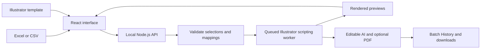

# RowCraft

**Turn spreadsheet rows into personalized Illustrator cards.**

RowCraft is a local web application that connects your Excel data to your Adobe Illustrator artwork. Choose the people you want to include, map spreadsheet columns to the text in your design, and generate one editable Illustrator file with an optional matching PDF.

It solves a familiar problem: **the design is ready, the data is in a spreadsheet, and somebody still has to copy every name, score, city, or other detail into the artwork.**

RowCraft automates that repetition while giving you control over the records, fields, sections, and finished output.

> **Current platform:** Windows with an installed, licensed Adobe Illustrator desktop application. The interface runs in your browser; Illustrator generates the artwork locally in the background.

Apple Silicon macOS support is being prepared for QA. The Mac connection, ARM64 DMG configuration and manual GitHub Actions build are included; macOS packaging and real Illustrator validation must pass before it is considered supported. See [Mac build and QA instructions](desktop/MACOS.md).

## Windows desktop application

RowCraft also runs as an Electron desktop app using this same web interface and renderer. Its installer includes Node.js and requires Adobe Illustrator before continuing. It does not require users to start a server or install Python. The web application remains available.

Build the installer with `npm run desktop:dist` (Node 22.12+ on Windows x64). Outputs appear in `release/`. See [desktop setup, local data, and build instructions](desktop/README.md). The first desktop release is an unsigned private pilot.

## Why use RowCraft?

Personalizing a few cards is manageable. Repeating the same edits for a larger list becomes tedious, especially when the artwork has several sections or the list changes regularly.

RowCraft helps you:

- **Reduce repetitive work.** Apply the same field connections to selected records instead of copying each value by hand.
- **Control exactly who appears.** Check individual people or choose an inclusive record range before generating.
- **Keep the original design.** Reuse native card groups, typography, artwork, and existing spacing.
- **Handle several sections together.** Give each section its own people, mappings, heading, and month within one output file.
- **Keep the result editable.** Receive an `.ai` file you can refine in Illustrator, plus a PDF when you need a print copy.
- **Review before a large batch.** Inspect an Illustrator-rendered proof and text-fit warnings first.
- **Process files on your computer.** Routine batch generation uses the local Illustrator worker, without a cloud API key or AI-token consumption.

Read the [card image workflow and engineering details](CARD-IMAGES.md) for image sources, crop controls, template preparation and limits.

## Who is it for?

| User | A practical use |
| --- | --- |
| Graphic designers | Personalize an existing card layout from a client's spreadsheet while retaining editable artwork. |
| Print shops | Prepare batches of name cards, recognition cards, or other repeated card designs with less manual data entry. |
| Marketing and sales teams | Create retailer or participant winner boards with separate groups, headings, and reporting months. |
| Event organizers | Fill a prepared attendee-card template with names, organizations, roles, or other mapped details. |
| Schools and community groups | Populate recognition or membership card layouts from a participant list. |
| Occasional users | Use a template prepared by a designer for a personal event or community activity, then manage the spreadsheet and selections through the browser. |

The value is the same across these situations: spend less effort repeating text edits and more effort checking the people, design, and finished result. An occasional user still needs access to licensed Illustrator and a suitable template.

## Main features

| Feature | What it gives you |
| --- | --- |
| Excel and CSV preview | Inspect worksheets and columns before generating. |
| Individual and range selection | Include exactly the records you need. Search, sort, and page through the list. |
| Illustrator artboard preview | See the source design, zoom in, and pan around it. |
| Click-to-map fields | Connect an editable artwork label to any Excel column. Clicking a label locates its control and highlights its number. |
| Single-card batches | Repeat one sample card across the selected page layout. |
| Optional card photos | Use Excel image URLs/filenames or one shared photo, with Fit/Fill and drag adjustment. |
| Multiple sections | Assign independent record selections, mappings, headings, and months to different artwork areas. |
| Native proof rendering | Check actual Illustrator output before generating a larger batch. |
| Combined output | Get one editable AI document and an optional matching multi-page PDF. |
| Batch History | Find creation times, download links, page previews, saved folders, and review notes. |
| Light and dark themes | Choose the appearance that suits your workspace. |

Starting an upload, template analysis, proof, or export shows a toast and brings its progress into view. Section ranges update automatically as soon as both endpoints are valid; Review remains accessible to inspect setup issues, while generation still requires a valid configuration. The Illustrator availability badge keeps its neutral appearance with a light-green pulsing dot, respecting reduced-motion preferences.

Generation follows the original worksheet order, even when the preview is sorted differently. **Record 1 means the first participant after the header.** Original Excel row numbers are retained; blank spacers and repeated headers are excluded from participant numbering.

## How to use it

### Single card batch

Use this when one card design and one record selection should fill the chosen page layout.

1. **Choose your people.** Upload an `.xlsx` or `.csv`, choose a worksheet, and select records individually or by range.
2. **Load your design.** Upload an `.ai` file, or a ZIP containing one AI file and its linked images. Choose the required artboard.
3. **Choose a sample card.** Select one complete card as the repeating unit.
4. **Map the fields.** Connect its name, score, city, or other editable labels to Excel columns. Unmapped text stays unchanged.
5. **Review and generate.** Render a native proof, check the text fit, and generate your files.

For example, records **1–5** produce **five populated cards in one AI file**. Unused detected cards on the chosen page are removed. Additional records continue on matching artboards with the original spacing.

Single-card mode also supports page-text mappings, added page text positions, and saved named card mappings for reuse with matching spreadsheet column names. Page fields use the first selected participant; card fields use each participant's own row.

### Multiple sections

Use this when different areas of the artwork need different people or page labels. Sections can share an artboard or appear on separate artboards.

| Setting | First section | Second section |
| --- | --- | --- |
| Participant range | 1–10 | 20–30 |
| Populated cards | 10 | 11 |
| Heading | Monthly winners | Regional winners |
| Month / year | January 2026 | February 2026 |

This example produces **21 populated cards in one editable AI file**, with a matching PDF if enabled.

1. Choose **Multiple sections** in **Card & fields**.
2. Select an artboard and draw a box around the complete cards for the first section. Precise percentage inputs are available as a keyboard alternative.
3. Set that section's record range, choose its sample card, and map its fields.
4. Select its heading and month labels in the artwork. Enter fixed text or choose an Excel column. Column-based page labels use the section's first selected participant.
5. Add the next section with its own selection and labels.
6. Review the counts, preview the section pages, and generate the combined output.

Unused card positions **inside each configured section** are removed. Artwork outside the boxes stays unchanged. Sections on the same source artboard share continuation pages; an exhausted section has no extra cards, while its heading and month continue to repeat.

See the [multi-section guide](MULTI_SECTION_GUIDE.md) for the full workflow and overflow behavior.

## Getting started

### Requirements

| Requirement | Details |
| --- | --- |
| Operating system | Windows. Native Illustrator automation for macOS and Linux is not implemented in this version. |
| Adobe Illustrator | Installed and licensed desktop application with its Windows automation interface available. |
| Node.js and npm | Node `20.19+` or `22.12+`, as required by this project's Vite dependency. Use a supported Node release meeting that requirement. |
| Python | Python `3.9+` for ZIP extraction and output packaging. No extra Python packages are needed for the normal ZIP workflow. |
| Template resources | The design's fonts and linked images. Repeated cards must contain editable, grouped content. |

### Install and start

Clone or download this repository. Open a terminal in the application folder containing `package.json`, then run:

```sh
npm ci
npm run dev
```

Open [http://127.0.0.1:5173/](http://127.0.0.1:5173/).

This starts Vite and the local API, which uses port `4317`. Keep the terminal open while using the application; press `Ctrl+C` to stop it.

Python should be available as `python` on your PATH. If it is installed elsewhere, set the `PYTHON` environment variable to its executable's full path before starting the app. A bundled Codex runtime is recognized when present, but is not required for other installations.

The optional [Windows launcher](Start%20Cover%20Studio.cmd) also starts the development app. It uses a bundled Codex Node runtime when available and otherwise uses `node` from your PATH.

### Run the built application

```sh
npm run build
npm start
```

Open [http://127.0.0.1:4317/](http://127.0.0.1:4317/). This serves the built interface and API from one local address.

The **Use supplied workbook/design** buttons depend on sample files in the sibling `excel` and `illustrations` directories. If your checkout does not include those assets, upload your own files instead.

## Preparing your files

### Spreadsheet

Use a header row with meaningful column names and one participant per data row. For example:

| Name | Organization | City | Month |
| --- | --- | --- | --- |
| Alex Morgan | Northside Club | Bristol | January 2026 |
| Sam Lee | Community Centre | Leeds | January 2026 |

Column names do not need to match the artwork labels: the mapping controls establish those connections. Save identifiers such as telephone numbers as text when leading zeros must be retained. Recalculate and save workbooks containing formulas before importing them.

### Illustrator template

- Use separate Illustrator groups for repeated cards, with at least two live text fields per detected card.
- Keep replacement fields as editable text. Outlined or flattened text cannot be mapped as native text.
- Use separate heading/month text objects for sections that need independent values.
- Embed external images or include them alongside the AI file in a ZIP.
- Install the fonts used by the design before rendering.

Detection uses repeated group sizes. Flattened pages, ungrouped cards, and unusual group structures may need preparation in Illustrator. A designer can prepare a reusable template once; the browser then handles routine selection and mapping.

## How it works



The browser displays artwork rendered by Illustrator and overlays the editable fields reported by the document. It sends your selections and mappings to the local API. The backend validates them and uses PowerShell with Windows COM to run JavaScript inside Illustrator.

Illustrator works on isolated source copies, fills native text objects, repeats the selected card groups, and saves a new output document. Jobs run one at a time because they share the local Illustrator application.

For the complete implementation walkthrough, see [Engineering Flow](ENGINEERING_FLOW.md).

## Output and local data

| Output | Purpose |
| --- | --- |
| `personalized-covers.ai` | One editable Illustrator document containing the populated pages. |
| `personalized-covers.pdf` | Optional matching PDF for review or printing. |
| ZIP download | Generated files, up to five page-preview images, and the output manifest. |
| `manifest.json` | Selections, mappings, output pages, and card assignments. |

The uploaded AI is never overwritten. Generated files live under `.local/jobs/<batch-id>/output`; Batch History displays the saved folder. Browser downloads create separate copies in your usual download location.

Imports, previews, saved single-card mappings, and job history are stored under `.local/`, which is ignored by Git. Review any manually created backups before publishing your repository. The server listens on `127.0.0.1` and is intended for one local workstation user.

## Current limits

- **5,000 selected records** in single-card mode, or **5,000 generated cards across up to 20 sections** in multi-section mode, subject to Illustrator's canvas limits.
- Spreadsheet previews accept up to **100,000 rows and 500 columns per worksheet**.
- Original typography is preserved by default. Long values are flagged for review. The optional **Condense long text to fit** setting changes character width.
- Check native proofs before large batches. The PDF is not a certified press preset; confirm bleed, color, and printer requirements for your job.
- Multi-section setup stays in the active browser workspace when switching steps. Reloading or changing the workbook, worksheet, or template clears it. Section presets are not implemented in this version.
- Local Illustrator is required. Cloud rendering and multi-user hosting are not implemented.

## Troubleshooting

| Problem | What to check |
| --- | --- |
| The page cannot be reached | Start the app from its application folder and keep the terminal open. Use port `5173` for development or `4317` after building and starting. |
| Workbook error: `Cannot read properties of undefined (reading 'sheets')` | Some XLSX generators use XML namespace prefixes the current ExcelJS reader does not recognize. Open the workbook in Excel and **Save As** a new `.xlsx`, or export the required sheet as CSV. This is an importer compatibility limitation. |
| A formula cell is rejected | Recalculate and save the workbook in Excel so its results are available. Resolve Excel error cells before importing. |
| No editable card is detected | Check that the card is a separate native group with live text fields. Analyze the structure again if the saved template is older. |
| Missing images or fonts | Include linked images in a template ZIP and install the design's fonts. |
| Text exceeds its available width | Shorten the value, adjust the template, or explicitly enable condensation and inspect a new proof. |
| Sections cannot share a card or page label | Draw disjoint card areas and assign separate heading/month text objects to each section. |
| Illustrator appears stuck | Check for a blocking Illustrator dialog and let the current job finish before starting another. |
| A download URL starts with `/api/` | This is an HTTP route, not a Windows folder. Use the download button or the saved folder displayed in Batch History. |

For an empty test workspace, follow the backup-and-reset instructions in [How it works](HOW_IT_WORKS.md#start-fresh-without-adding-a-reset-feature).

## Technology and development

| Responsibility | Technology |
| --- | --- |
| Frontend | React 19, TypeScript, Vite |
| Components and styling | shadcn/ui, Radix UI / Base UI, Tailwind CSS, shared theme variables |
| Motion and artwork navigation | Motion for React, React Zoom Pan Pinch |
| Workbook parsing and selection | ExcelJS, TanStack Table |
| Local API and uploads | Node.js, Express, Multer |
| Artwork and PDF generation | Adobe Illustrator JavaScript, Windows COM, PowerShell |
| ZIP extraction and packaging | Python standard library |

```sh
npm test
npm run build
```

The automated suite covers workbook parsing, stable record selections, mapping validation, section ownership and pagination, canvas limits, and download routes. Separate native integration checks generate artwork, reopen it in Illustrator, and compare card counts, field values, and typography. Native checks require Illustrator and the supplied sample assets.

| Documentation | Read it for |
| --- | --- |
| [Multi-section guide](MULTI_SECTION_GUIDE.md) | Independent ranges, headings/months, and section overflow. |
| [Engineering Flow](ENGINEERING_FLOW.md) | Frontend-to-backend flow, preview geometry, native automation, and downloads. |
| [How it works](HOW_IT_WORKS.md) | Local storage, processing, and starting fresh. |
| [Manual testing](MANUAL_TESTING.md) | A checklist for trying the workflow on your own machine. |
| [Verified results](TEST_RESULTS.md) | Recorded automated, native Illustrator, and download checks. |

**Start with a small batch, inspect the proof, then generate the full selection.**
